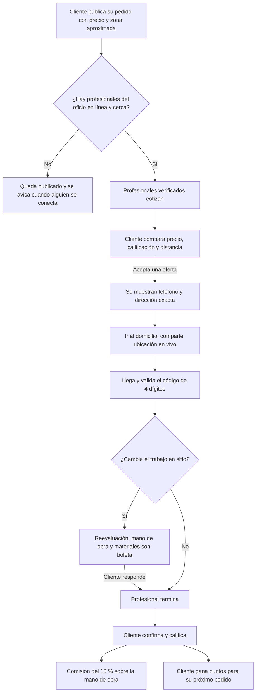
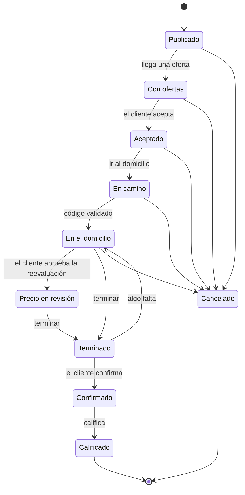
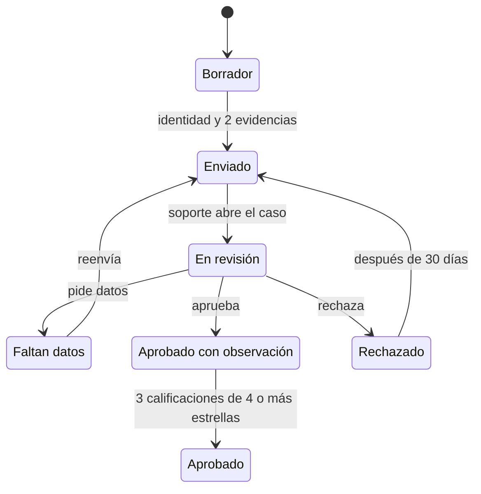
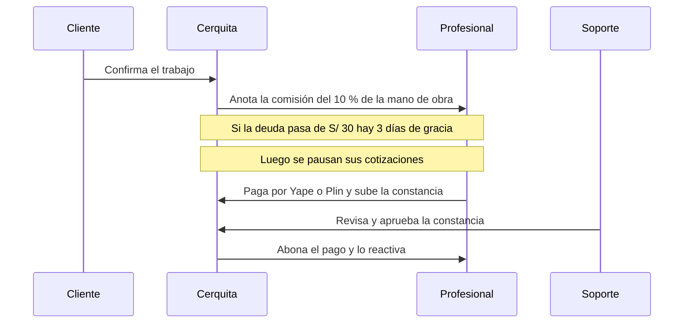
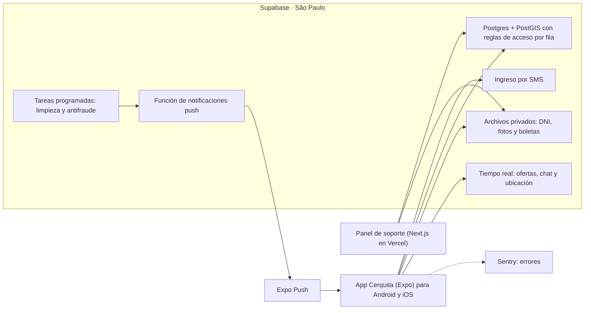

# Cerquita · Flujos del producto

Diagramas de los flujos ya construidos y probados. GitHub los dibuja solo. La demo interactiva que los recorre está en [`docs/demo/cerquita-demo.html`](demo/cerquita-demo.html): ábrela con doble clic en el navegador (es una simulación con datos de ejemplo; no se conecta a la base).

## 1. De un pedido al pago de la comisión

El cliente pone su precio y solo comparte su zona aproximada. Los profesionales cotizan si tienen ese oficio aprobado, están en línea y dentro de su radio. El teléfono y la dirección exacta se muestran recién al aceptar una oferta.

## 2. Estados de un pedido

Cada cambio de estado lo valida el servidor. Por ejemplo, solo el profesional asignado puede marcar que llegó, y solo con el código correcto.

## 3. Verificación del profesional

Por cada oficio: identidad (DNI, selfie y antecedentes) y al menos dos evidencias. Los documentos van a un almacenamiento privado y cada vista del equipo de soporte queda registrada.

## 4. Comisión y pagos

La comisión se anota en un libro de cuentas que no se puede editar. No hay compras ni recargas dentro de la app: el profesional paga por Yape, Plin o transferencia y sube su constancia.

## 5. Cómo está armado por dentro

## Dónde vive cada pieza

| Pieza | Dónde | Ahora (pruebas) | Al lanzar |
| --- | --- | --- | --- |
| Código | GitHub privado | Gratis | Gratis |
| Base, ingreso SMS y archivos | Supabase · São Paulo (`sa-east-1`) | Gratis (se pausa tras 1 semana sin uso) | Pro: USD 25/mes, copias diarias |
| Panel de soporte | Vercel (`apps/admin`) | Gratis (Hobby, uso no comercial) | Pro: USD 20/mes por persona |
| App Android e iOS | Expo EAS (Build, Submit, Update) | Gratis con cupo mensual | Gratis o plan pago según builds |
| Tiendas | Google Play · App Store | — | USD 25 una vez · USD 99/año |
| SMS | Twilio u otro con remitente en Perú | Números de prueba | Pago por mensaje |
| Errores | Sentry | Gratis | Gratis al inicio |

Precios de referencia: confírmalos antes de contratar. Pasos de despliegue en [`produccion.md`](produccion.md).
